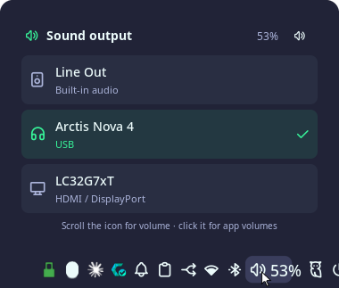

# Sound output bar button

A volume button for the [Noctalia](https://noctalia.dev) bar with a hover
popup for switching the sound output (speakers, headset, HDMI monitor…).



- **Hover** the volume icon: a popup above it lists your outputs, the current
  one ticked. Click one to switch; audio that's already playing moves over too.
  The button at the top mutes.
- **Click** the icon: Noctalia's audio panel (per-app volumes), as before.
- **Scroll** for volume (1% steps), **right click** to mute, the same as the
  built-in volume widget it replaces.

## Install

```bash
./install.sh
```

It puts the button where the built-in `volume` widget was. Re-running it is
safe and also updates an existing install. `./uninstall.sh` removes it and
puts the built-in widget back.

Requirements: Noctalia 5.4+, PipeWire with `pipewire-pulse` (or PulseAudio),
`pactl`, `jq` and `python3`.

## What gets installed where

| File | Purpose |
| --- | --- |
| `~/.local/bin/sound-output` | Does the work: `status` (JSON), `set <sink>`, `mute`. |
| `~/.local/share/noctalia-local-plugins/sound-output/` | The Noctalia plugin (`ps/sound-output`), registered as plugin source `local`. |

The installer also adds a `[widget.sound-output]` entry to Noctalia's settings
(`~/.local/state/noctalia/settings.toml`) and swaps it into the bar's widget list.

## Output names

PipeWire's own names are long ("GA104 High Definition Audio Controller Digital
Stereo (HDMI)"), so the popup shows shorter ones: the monitor's name for
HDMI/DisplayPort, the product name for USB and Bluetooth devices, and the jack
(Line Out, Headphones) for built-in audio. Change the `label`, `detail` and
`icon` rules in `bin/sound-output` to rename them.

## Notes

- The volume updates live from `pactl subscribe`, with a 10 s poll as backup.
- Attached panels can only align to an end of the bar, not to a widget, so the
  popup is `position = "bottom_right"` and 380px wide to sit over the icon.
  Change `width` or `position` in `plugin.toml` if it doesn't on your screen.
- Noctalia hot-reloads the `.luau` files; after changing `plugin.toml`, run
  `./install.sh` again.
